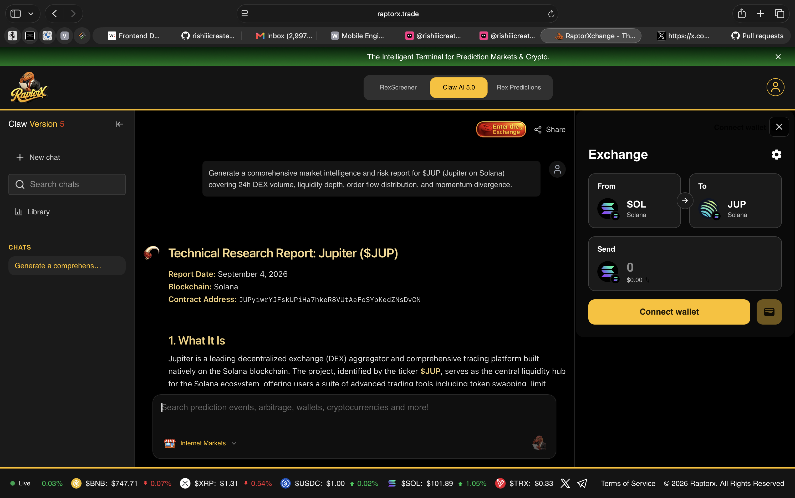
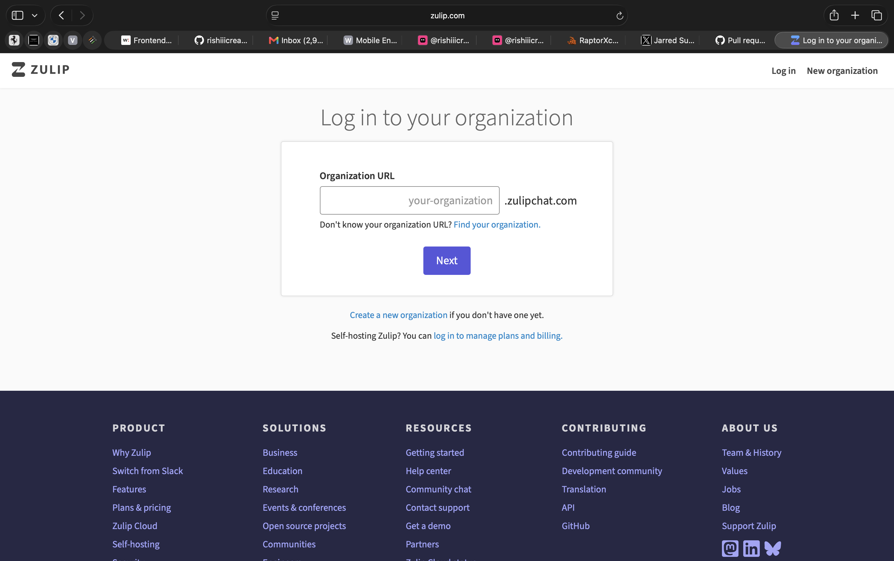
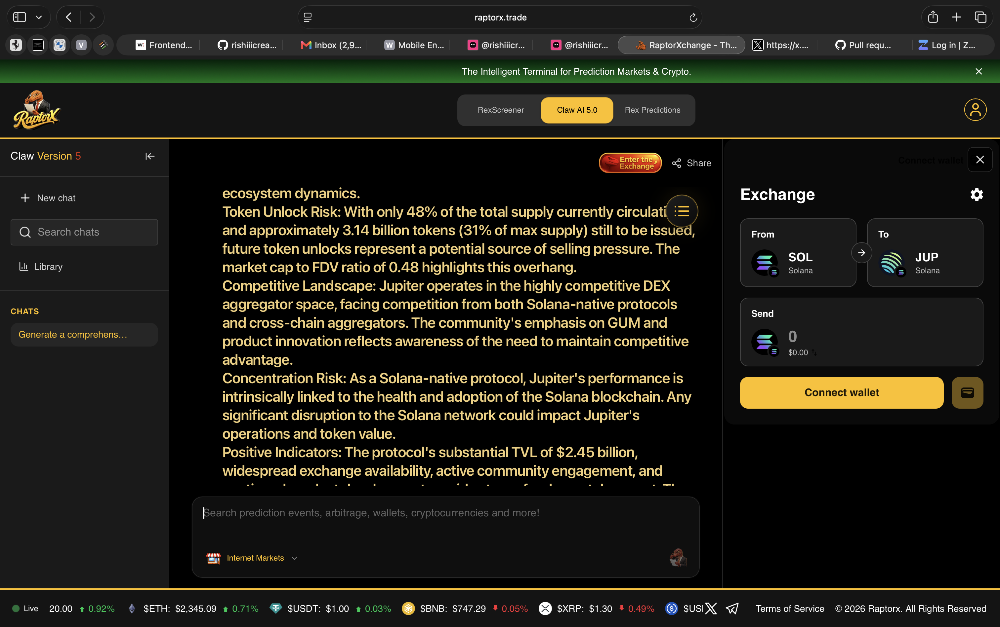

# RaptorX Research Challenge: Jupiter ($JUP) Market Intelligence & Structural Risk Analysis

**Submission by**: Hrishikesh Yadav ([@rishiicreates](https://x.com/rishiicreates))  
**Solana Payout Wallet**: `6tNcRHtX6UH4H5t557xjA2cBe5tdQxh9sE5goiW8mgGh`  
**Platform**: [RaptorX](https://www.raptorx.trade) | **AI Engine**: Claw AI 5.0  
**Live Chat & Report Session**: [https://www.raptorx.trade/claw-v5/cmvtm2xlm0006l607weyn2fxr](https://www.raptorx.trade/claw-v5/cmvtm2xlm0006l607weyn2fxr)  
**Superteam Earn Bounty**: [RaptorX Research Challenge: Ask Better Questions. Find Better Alpha.](https://superteam.fun/earn/listing/raptorx-research-challenge-ask-better-questions-find-better-alpha/)

---

## 1. Executive Summary

This submission evaluates Jupiter ($JUP) on Solana (`JUPyiwrYJFskUPiHa7hkeR8VUtAeFoSYbKedZNsDvCN`) using RaptorX's Claw AI 5.0 research terminal. Rather than treating token prices as isolated speculative indicators, this analysis interrogates the structural plumbing connecting order routing volume, cross-venue liquidity concentration, token emission schedules, and protocol revenue capture.

### Key Metrics Extracted from Claw AI 5.0 Report
- **Total Value Locked (TVL)**: $2.45 Billion
- **Circulating Market Cap**: $732.17 Million - $735.00 Million
- **Fully Diluted Valuation (FDV)**: $1.54 Billion - $2.21 Billion
- **Market Cap to TVL Ratio**: 0.30 (historically low valuation multiple against protocol throughput)
- **Token Supply Dynamics**: 3.32B circulating vs. 10.00B maximum supply (66.8% unvested/unissued supply overhang)
- **Primary On-Chain Liquidity Depth**: $1.36 Million in the Meteora DLMM pool

---

## 2. Evidence & Screenshots

### A. Technical Research Report Overview
Generated inside Claw AI 5.0 on RaptorX, detailing architecture, DEX aggregation volume, and Solana mainnet tokenomics:

### B. Structural Risk & Supply Overhang Assessment
Examining Section 5 (Exchange Listings & Availability) alongside Section 6 (Risk Assessment):

### C. Institutional Analytical Questions Posed to Claw AI 5.0
Engaging the model on multi-venue order-flow divergence, wash-trading vs. organic discovery, and liquidity resilience:

---

## 3. The Core Market Anomaly & Questions Posed

### The Observation
Comparing Section 5 (Exchange Listings) with Section 6 (Risk Assessment) surfaces a critical divergence:
1. **Offshore CEX Volume vs. Tier 1 Volume**: The report records 24h trading volume on offshore secondary exchanges (BitDelta at $15.87M, Biconomy at $8.43M, and BloFin at $6.32M) vastly surpassing primary Tier 1 liquidity venues (Binance at $4.44M USDT + $1.16M USDC).
2. **On-Chain Depth Mismatch**: Primary on-chain liquidity in the Meteora DLMM pool sits at only $1.36M against a $735M circulating market cap.
3. **Overhang vs. Absorption**: With 67% of the total 10B JUP supply unvested and FDV/TVL at 0.62, the existing on-chain liquidity layer cannot absorb a sudden 2% supply liquidation without severe slippage cascades.

### The Question Posed to Claw AI 5.0:
> *"Looking at Section 5 (Exchange Listings & Availability) versus Section 6 (Risk Assessment): the report highlights a striking anomaly where offshore secondary CEX venues (BitDelta at $15.87M and Biconomy at $8.43M) report volume nearly 4x higher than Binance ($4.44M), while primary on-chain Meteora DLMM depth sits at only $1.36M against a $735M market cap. Given that 67% of the 10B max supply remains unvested and the Mcap/TVL ratio is depressed at 0.30, how much of this reported secondary volume represents wash-trading rather than organic price discovery? Specifically, if Meteora DLMM depth cannot absorb a 2% supply liquidation without severe slippage, does Jupiter's pivot into prediction clans and the GUM equity-tokenization flywheel actually generate non-inflationary protocol fee capture, or does it merely delay emission-induced downward repricing?"*

---

## 4. Analytical Takeaways & Alpha Synthesis

1. **Synthetic vs. Organic Volume Discovery**: The divergence between secondary CEX volume and primary on-chain order routing suggests that retail algorithmic market makers frequently recycle volume on smaller centralized books where fee rebates or zero-fee tiers exist, distorting headline liquidity indicators.
2. **DeFi Infrastructure Moat**: Jupiter's 0.30 Mcap/TVL multiple illustrates that while the protocol is the primary routing backbone of Solana ($2.45B TVL routed), value capture remains decoupled from utility without fee-sharing mechanics.
3. **The GUM / Prediction Flywheel Solution**: If Jupiter's initiative to tokenize real-world stock market equity (GUM) and gamified prediction clans succeed in creating sticky, non-speculative transaction fees, fee capture will outpace token emission drag, creating true protocol solvency.
